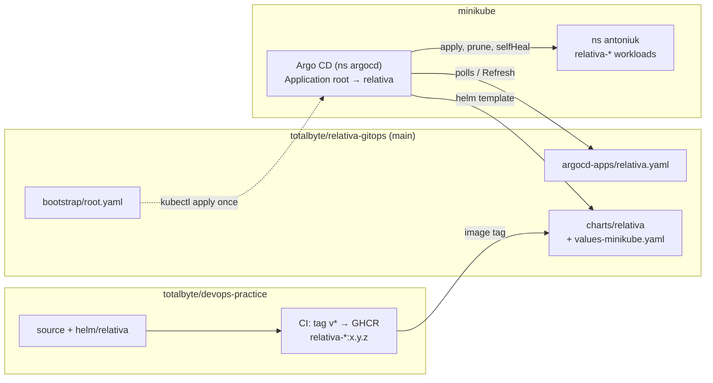

# GitOps -- Argo CD and the `relativa-gitops` Repository

> **Last verified:** 2026-10-28 (Initial GitOps setup: Argo CD v3.5.6 on minikube, App of Apps from `totalbyte/relativa-gitops`, chart 0.2.0, images `1.1.0` → `1.2.0`.)

> **Maintenance obligation:** If you change the Argo CD setup -- the `Application` objects, `values-minikube.yaml`, the sync policy, the Argo CD version -- or anything under `helm/relativa/` that the GitOps copy must follow, update this file and its "Last verified" date, and [GITOPS-LAB5.md](../runbooks/GITOPS-LAB5.md) if demo commands change. See [AI-GUIDES-INDEX.md](../../AI-GUIDES-INDEX.md) for the full update matrix.

> **Note:** The step-by-step Lab 5 commands (PowerShell) are in [docs/runbooks/GITOPS-LAB5.md](../runbooks/GITOPS-LAB5.md). This guide explains the setup and why it is built this way.

---

## Model



- **Desired state** lives in the `main` branch of `relativa-gitops`. Nothing in namespace `antoniuk` is applied by hand except the Secret `relativa-secrets` (see below).
- **Release** = a commit that changes `image.tag` in `charts/relativa/values-minikube.yaml`. CI in the application repository only builds and publishes images (tag `v1.2.0` → `ghcr.io/totalbyte/relativa-*:1.2.0`); it does not write to the GitOps repository.
- **Rollback** = `git revert` of that commit. `argocd app rollback` is refused while automated sync is on, and Argo CD would sync back to Git anyway.

---

## Why a separate repository

The lab allows either `<project>-gitops` or `bootstrap/` + `argocd-apps/` + `charts/` inside the application repository. The separate repository is used because of the application repository's branch protection ([CI-PIPELINE.md](CI-PIPELINE.md) → "Branch protection"):

- `main` accepts changes only through a pull request with every required check green, so each tag bump, `selfHeal` switch or revert would need a PR and a full CI run (7 .NET jobs, 8 image builds with Trivy, E2E, k6).
- Skipping CI for GitOps paths (`paths-ignore`) would make such PRs wait forever for required checks that never report.

`relativa-gitops` is public (no `argocd repo add`), has no CI and no branch protection: a push to `main` is the deployment.

---

## Repository layout

```
relativa-gitops/
├── bootstrap/root.yaml          # Application "root": path argocd-apps, automated prune + selfHeal
├── argocd-apps/relativa.yaml    # Application "relativa": the chart, values-minikube.yaml, ns antoniuk
└── charts/relativa/             # copy of helm/relativa (identical files)
    └── values-minikube.yaml     # the only file that exists only here
```

| Application | Source path | Destination | Sync policy |
|---|---|---|---|
| `root` | `argocd-apps` (plain YAML) | `argocd` | automated, `prune`, `selfHeal` -- a pushed change to `relativa.yaml` is applied without a Refresh of `relativa` |
| `relativa` | `charts/relativa`, `helm.valueFiles: [values-minikube.yaml]` (relative to the chart path), `helm.skipTests: true` | `antoniuk`, `CreateNamespace=true` | automated, `prune`; `selfHeal: true` is added in Lab 5 step 6a |

- The `Application` name is the Helm release name, so object names are `relativa-*` exactly as with `helm install relativa`.
- `relativa` carries the `resources-finalizer.argocd.argoproj.io` finalizer: deleting the Application (or removing its file, which `root` prunes) deletes its workloads too.
- A future component (Argo Rollouts in Lab 6, monitoring in Lab 7) is one more file in `argocd-apps/`.

### Keeping the chart copies equal

`helm/relativa/` in the application repository stays the source of chart changes (it has the docs and the Lab 4 runbook). After changing it, copy the chart to `relativa-gitops/charts/relativa/` (all files except `values-minikube.yaml`) and check:

```bash
diff -r --strip-trailing-cr -x values-minikube.yaml helm/relativa ../relativa-gitops/charts/relativa
```

---

## What the chart needs under Argo CD

Argo CD runs `helm template` (no cluster access, no release object) and applies the output with its own diff and sync logic. Three chart features behave differently, and `values-minikube.yaml` / the Application handle each:

| Chart feature | Under Argo CD | Handling |
|---|---|---|
| Generated passwords via `lookup` (`relativa.secretValue`) | `lookup` returns nothing, so every render would produce new random passwords: a Secret that changes on each sync, and PostgreSQL/RabbitMQ initialised with a password the apps no longer have | `secrets.existingSecret: relativa-secrets` -- the chart renders no Secret; the Secret is created once with `kubectl create secret generic` (keys `DB_PASS`, `RABBITMQ_PASS`, `JWT_SECRET`). Argo CD does not track or prune it, because it is not in Git |
| `pre-upgrade` backup hook | Mapped to `PreSync`, which runs before **every** sync, including the first one, when PostgreSQL does not exist yet -- the first sync would fail | `backup.enabled: false` |
| `helm.sh/hook: test` pods | Would be rendered and synced | `helm.skipTests: true` in the Application |

Everything else works unchanged: the hashed migration Job name (a new image → a new Job, the old one is pruned), `checksum/config` rollouts, init containers waiting for the migration.

### Degraded needs a short progress deadline

Argo CD's Deployment health is `Progressing` until the Deployment reports `ProgressDeadlineExceeded`, then `Degraded`. With the Kubernetes default (600 s, the chart leaves the field unset) a broken image tag stays `Progressing` for 10 minutes. `values-minikube.yaml` sets `gateway.progressDeadlineSeconds: 60`; the other services keep 600 s. A global 90 s was tried first: the first sync on a fresh cluster then showed `Degraded` for about two minutes, because backends wait for the migration Job and pull images.

---

## Secrets

Not in Git in any form. Before the first sync:

```powershell
kubectl create namespace antoniuk
kubectl -n antoniuk create secret generic relativa-secrets --from-literal=DB_PASS=... --from-literal=RABBITMQ_PASS=... --from-literal=JWT_SECRET=...
```

Changing a password later means changing the Secret by hand and restarting the pods; PostgreSQL and RabbitMQ keep the password from their first initialisation (see [HELM.md](HELM.md) → "Checksums only where they help"). Sealed Secrets / SOPS / External Secrets would move this into Git; not used.

---

## Access

| What | Command | URL |
|---|---|---|
| Argo CD UI / CLI | `kubectl -n argocd port-forward svc/argocd-server 8443:443` | https://localhost:8443 (self-signed), `argocd login localhost:8443 --username admin --insecure` |
| Gateway | `kubectl -n antoniuk port-forward svc/relativa-gateway 8080:8080` | http://localhost:8080/version |
| Client | `kubectl -n antoniuk port-forward svc/relativa-client 3000:3000` | http://localhost:3000 (`Relativa v<version>` in the sidebar after login, `v<version>` in the login footer) |

Argo CD is **not** forwarded to 8080 (the upstream getting-started guide does that): the SPA calls the gateway at `http://localhost:8080` (`config.urls.gateway`) and the gateway allows CORS only from `http://localhost:3000`, so those two ports are fixed.

---

## Version endpoint

`GET /version` on the gateway returns `{"service":"relativa-gateway","version":"<x.y.z>","instance":"<pod>"}`. The version is baked into the image at build time (`APP_VERSION` build arg = release tag), not set by the chart, so it always names the image that is actually running. The client shows the same build-time version in the login footer and, since `1.2.0`, in the sidebar.

---

## Verified behaviour (minikube, Kubernetes 1.37, Argo CD v3.5.6)

Verified on a throwaway minikube profile with an in-cluster `git daemon` standing in for GitHub:

- `kubectl apply -f bootstrap/root.yaml` alone: `root` creates `relativa`, which syncs the whole stack; `Synced/Healthy` after ~3.5 min on a cluster without cached images.
- Image tag change: `OutOfSync` → `Synced/Progressing` → `Synced/Healthy` in ~1.5 min; all seven app Deployments roll, a new migration Job runs, the old one is pruned.
- `kubectl scale --replicas=5` without `selfHeal`: `OutOfSync`, replicas stay 5. Pushing `selfHeal: true`: `root` updates `relativa` within seconds and the existing drift is corrected right away (5 → 1); the next `kubectl scale` is undone in about a second.
- `gateway.image.tag: "9.9.9"`: `Synced/Progressing`, `Synced/Degraded` after ~60 s; the new pod is in `ImagePullBackOff`, the old pod keeps serving (`maxUnavailable: 0`).
- `git revert` of that commit: `Synced/Healthy` within seconds, the failed ReplicaSet scaled to 0. `status.history` (what `argocd app history` prints) lists one entry per synced commit.
