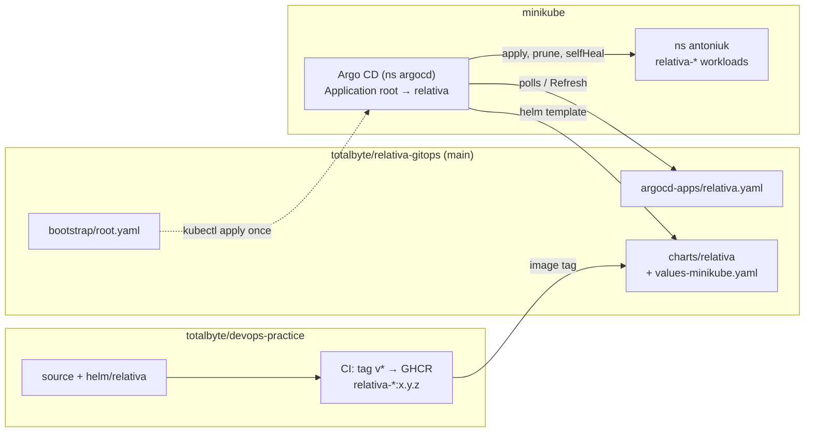

# GitOps -- Argo CD and the `relativa-gitops` Repository

> **Last verified:** 2026-11-19 (Lab 6: Argo Rollouts controller as an Application from `argocd-apps/`, gateway as a canary `Rollout`, `retry` on `relativa`, chart 0.3.0, images `1.3.0` / `1.4.0`; the demo commands are in [ROLLOUTS-LAB6.md](../runbooks/ROLLOUTS-LAB6.md).) Earlier: 2026-10-28 (Initial GitOps setup: Argo CD v3.5.6 on minikube, App of Apps from `totalbyte/relativa-gitops`, chart 0.2.0, images `1.1.0` → `1.2.0`.)

> **Maintenance obligation:** If you change the Argo CD setup -- the `Application` objects, `values-minikube.yaml`, the sync policy, the Argo CD version -- or anything under `helm/relativa/` that the GitOps copy must follow, update this file and its "Last verified" date, and [GITOPS-LAB5.md](../runbooks/GITOPS-LAB5.md) if demo commands change. See [AI-GUIDES-INDEX.md](../../AI-GUIDES-INDEX.md) for the full update matrix.

> **Note:** The step-by-step Lab 5 commands (PowerShell) are in [docs/runbooks/GITOPS-LAB5.md](../runbooks/GITOPS-LAB5.md). This guide explains the setup and why it is built this way.

---

## Model



- **Desired state** lives in the `main` branch of `relativa-gitops`. Nothing in namespace `antoniuk` is applied by hand except the Secret `relativa-secrets` (see below).
- **Release** = a commit that changes `image.tag` in `charts/relativa/values-minikube.yaml`. CI in the application repository only builds and publishes images (tag `v1.2.0` → `ghcr.io/totalbyte/relativa-*:1.2.0`); it does not write to the GitOps repository.
- **Rollback** = `git revert` of that commit. `argocd app rollback` is refused while automated sync is on, and Argo CD would sync back to Git anyway.

---

## Why a separate repository

The lab allows either `<project>-gitops` or `bootstrap/` + `argocd-apps/` + `charts/` inside the application repository. The separate repository is used because of the application repository's branch protection ([CI-PIPELINE.md](CI-PIPELINE.md) → "Branch protection"):

- `main` accepts changes only through a pull request with every required check green, so each tag bump, `selfHeal` switch or revert would need a PR and a full CI run (7 .NET jobs, 8 image builds with Trivy, E2E, k6).
- Skipping CI for GitOps paths (`paths-ignore`) would make such PRs wait forever for required checks that never report.

`relativa-gitops` is public (no `argocd repo add`), has no CI and no branch protection: a push to `main` is the deployment.

---

## Repository layout

```
relativa-gitops/
├── bootstrap/root.yaml          # Application "root": path argocd-apps, automated prune + selfHeal
├── argocd-apps/relativa.yaml    # Application "relativa": the chart, values-minikube.yaml, ns antoniuk
├── argocd-apps/argo-rollouts.yaml # Application "argo-rollouts": Helm chart from argo-helm, ns argo-rollouts
└── charts/relativa/             # copy of helm/relativa (identical files)
    └── values-minikube.yaml     # the only file that exists only here
```

| Application | Source path | Destination | Sync policy |
|---|---|---|---|
| `root` | `argocd-apps` (plain YAML) | `argocd` | automated, `prune`, `selfHeal` -- a pushed change to `relativa.yaml` is applied without a Refresh of `relativa` |
| `relativa` | `charts/relativa`, `helm.valueFiles: [values-minikube.yaml]` (relative to the chart path), `helm.skipTests: true` | `antoniuk`, `CreateNamespace=true` | automated, `prune`; `selfHeal: true` is added in Lab 5 step 6a; `retry` (5 attempts, 10 s × 2 up to 3 min) since Lab 6 |
| `argo-rollouts` | Helm chart `argo-rollouts` 2.43.12 (controller v1.10.2) from `https://argoproj.github.io/argo-helm`, `controller.replicas: 1` | `argo-rollouts`, `CreateNamespace=true` | automated, `prune`, `selfHeal`; `sync-wave: "-1"` |

- The `Application` name is the Helm release name, so object names are `relativa-*` exactly as with `helm install relativa`.
- `relativa` carries the `resources-finalizer.argocd.argoproj.io` finalizer: deleting the Application (or removing its file, which `root` prunes) deletes its workloads too.
- A further component (Argo Rollouts in Lab 6, monitoring in Lab 7) is one more file in `argocd-apps/`.

### Keeping the chart copies equal

`helm/relativa/` in the application repository stays the source of chart changes (it has the docs and the Lab 4 runbook). After changing it, copy the chart to `relativa-gitops/charts/relativa/` (all files except `values-minikube.yaml`) and check:

```bash
diff -r --strip-trailing-cr -x values-minikube.yaml helm/relativa ../relativa-gitops/charts/relativa
```

---

## What the chart needs under Argo CD

Argo CD runs `helm template` (no cluster access, no release object) and applies the output with its own diff and sync logic. Three chart features behave differently, and `values-minikube.yaml` / the Application handle each:

| Chart feature | Under Argo CD | Handling |
|---|---|---|
| Generated passwords via `lookup` (`relativa.secretValue`) | `lookup` returns nothing, so every render would produce new random passwords: a Secret that changes on each sync, and PostgreSQL/RabbitMQ initialised with a password the apps no longer have | `secrets.existingSecret: relativa-secrets` -- the chart renders no Secret; the Secret is created once with `kubectl create secret generic` (keys `DB_PASS`, `RABBITMQ_PASS`, `JWT_SECRET`). Argo CD does not track or prune it, because it is not in Git |
| `pre-upgrade` backup hook | Mapped to `PreSync`, which runs before **every** sync, including the first one, when PostgreSQL does not exist yet -- the first sync would fail | `backup.enabled: false` |
| `helm.sh/hook: test` pods | Would be rendered and synced | `helm.skipTests: true` in the Application |

Everything else works unchanged: the hashed migration Job name (a new image → a new Job, the old one is pruned), `checksum/config` rollouts, init containers waiting for the migration.

### Degraded needs a short progress deadline

Argo CD's Deployment health is `Progressing` until the Deployment reports `ProgressDeadlineExceeded`, then `Degraded`. With the Kubernetes default (600 s, the chart leaves the field unset) a broken image tag stays `Progressing` for 10 minutes. `values-minikube.yaml` sets `gateway.progressDeadlineSeconds: 60`; the other services keep 600 s. A global 90 s was tried first: the first sync on a fresh cluster then showed `Degraded` for about two minutes, because backends wait for the migration Job and pull images.

---

## Secrets

Not in Git in any form. Before the first sync:

```powershell
kubectl create namespace antoniuk
kubectl -n antoniuk create secret generic relativa-secrets --from-literal=DB_PASS=... --from-literal=RABBITMQ_PASS=... --from-literal=JWT_SECRET=...
```

Changing a password later means changing the Secret by hand and restarting the pods; PostgreSQL and RabbitMQ keep the password from their first initialisation (see [HELM.md](HELM.md) → "Checksums only where they help"). Sealed Secrets / SOPS / External Secrets would move this into Git; not used.

---

## Access

| What | Command | URL |
|---|---|---|
| Argo CD UI / CLI | `kubectl -n argocd port-forward svc/argocd-server 8443:443` | https://localhost:8443 (self-signed), `argocd login localhost:8443 --username admin --insecure` |
| Argo Rollouts dashboard | `kubectl argo rollouts dashboard` (the plugin serves it locally, no port-forward) | http://localhost:3100 |
| Gateway | `kubectl -n antoniuk port-forward svc/relativa-gateway 8080:8080` | http://localhost:8080/version |
| Client | `kubectl -n antoniuk port-forward svc/relativa-client 3000:3000` | http://localhost:3000 (`Relativa v<version>` in the sidebar after login, `v<version>` in the login footer) |

Argo CD is **not** forwarded to 8080 (the upstream getting-started guide does that): the SPA calls the gateway at `http://localhost:8080` (`config.urls.gateway`) and the gateway allows CORS only from `http://localhost:3000`, so those two ports are fixed.

---

## Version endpoint

`GET /version` on the gateway returns `{"service":"relativa-gateway","version":"<x.y.z>","instance":"<pod>"}`. The version is baked into the image at build time (`APP_VERSION` build arg = release tag), not set by the chart, so it always names the image that is actually running. The client shows the same build-time version in the login footer and, since `1.2.0`, in the sidebar.

---

## Progressive delivery (Argo Rollouts, Lab 6)

The gateway runs as an Argo Rollouts `Rollout` instead of a Deployment (`gateway.rollout.enabled: true` in `values-minikube.yaml`, chart mechanics in [HELM.md](HELM.md)). The other six services stay Deployments.

### Controller from Git

`argocd-apps/argo-rollouts.yaml` installs the upstream Helm chart; `root` picks the file up like `relativa.yaml`. The chart brings the CRDs (`rollouts`, `analysistemplates`, `analysisruns`, `experiments`, `clusteranalysistemplates`), the controller (one replica instead of the chart default of two, single-node minikube) and RBAC. The CLI plugin `kubectl-argo-rollouts` (same version, v1.10.2) is a local binary, not a cluster object.

`sync-wave: "-1"` orders the Application before `relativa` inside `root`, but Argo CD does not wait for a child Application to become healthy, so on a fresh cluster `relativa` can still reach the API server before the CRDs exist (`no matches for kind "Rollout"`). Hence the `retry` on `relativa`, and the controller was committed and synced before the `Rollout` reached the chart.

### Strategy: canary

```yaml
gateway:
  replicaCount: 5
  rollout:
    enabled: true
    strategy:
      canary:
        maxSurge: 1
        maxUnavailable: 0
        steps:
          - setWeight: 20
          - pause: {}
          - setWeight: 60
          - pause: {duration: 30s}
          - setWeight: 80
          - pause: {duration: 30s}
```

- **Why canary, not blue-green.** The gateway is the single entry point of the API: a canary exposes a new version to a fifth of the requests first and can be stopped there, blue-green switches all traffic at once. The gateway is stateless and both versions talk to the same backends, so mixed traffic is safe. Canary needs one extra pod (`maxSurge: 1`), blue-green a second full set. Blue-green would suit the SPA (`client`) better, where an HTML page of one version must not load assets of another.
- **No traffic router.** There is no service mesh or Ingress-based split: the weight is the share of pods behind the one `relativa-gateway` Service. With 5 replicas, 20 / 60 / 80 % are exactly 1 / 3 / 4 new pods, and kube-proxy spreads requests over all ready pods. `kubectl port-forward svc/...` pins one pod, so the split is only visible from inside the cluster (a `kubectl run ... curlimages/curl` loop on `http://relativa-gateway:8080/version`).
- **Release** = a commit that changes `gateway.image.tag` (the gateway alone, so `abort` leaves the rest of the stack untouched). The first revision after the switch from the Deployment, and any change outside the pod template, skips the steps.

### What Argo CD shows

| Rollout state | Argo CD Sync / Health | How it comes about |
|---|---|---|
| Paused on `pause: {}` or a timed pause | `Synced` / `Suspended` | `kubectl argo rollouts promote` or the `Resume` action in the UI continues |
| Moving between steps | `Synced` / `Progressing` | |
| All pods on the new revision | `Synced` / `Healthy` | ~1 min after `promote` (two 30 s pauses) |
| `kubectl argo rollouts abort` | `Synced` / `Degraded` | canary ReplicaSet scaled to 0, all pods back on the stable revision |

`promote` and `abort` change only the Rollout `status`, never the `spec`, so the live manifest still equals Git: `Synced` throughout, and `selfHeal` has nothing to undo. After `abort`, Git still names the new tag while the cluster deliberately runs the old one, so the Rollout reports `Degraded` (`RolloutAborted`). The release is finished through Git: `git revert` of the tag commit puts the stable template back into `spec`, the Rollout recognises its own stable ReplicaSet and is `Healthy` within seconds, without restarting a pod. `kubectl argo rollouts retry rollout` would instead restart the same release from step 1.

---

## Verified behaviour (minikube, Kubernetes 1.37, Argo CD v3.5.6)

Verified on a throwaway minikube profile with an in-cluster `git daemon` standing in for GitHub:

- `kubectl apply -f bootstrap/root.yaml` alone: `root` creates `relativa`, which syncs the whole stack; `Synced/Healthy` after ~3.5 min on a cluster without cached images.
- Image tag change: `OutOfSync` → `Synced/Progressing` → `Synced/Healthy` in ~1.5 min; all seven app Deployments roll, a new migration Job runs, the old one is pruned.
- `kubectl scale --replicas=5` without `selfHeal`: `OutOfSync`, replicas stay 5. Pushing `selfHeal: true`: `root` updates `relativa` within seconds and the existing drift is corrected right away (5 → 1); the next `kubectl scale` is undone in about a second.
- `gateway.image.tag: "9.9.9"`: `Synced/Progressing`, `Synced/Degraded` after ~60 s; the new pod is in `ImagePullBackOff`, the old pod keeps serving (`maxUnavailable: 0`).
- `git revert` of that commit: `Synced/Healthy` within seconds, the failed ReplicaSet scaled to 0. `status.history` (what `argocd app history` prints) lists one entry per synced commit.
- Argo Rollouts (Lab 6, v1.10.2): `argo-rollouts` Application `Synced/Healthy` in ~20 s with all five CRDs. Switching the gateway to a `Rollout`: Argo CD prunes the Deployment and creates the Rollout; 5 pods ready in ~40 s, no steps on the first revision. The chart bump to 0.3.0 also rolls the other app pods (ConfigMap checksum, see [HELM.md](HELM.md)), so `relativa` is `Progressing` for a minute.
- Tag change on the gateway: the Rollout stops at step 1 (`SetWeight 20`, one canary pod, four stable), Argo CD `Synced/Suspended`; an in-cluster `curl` loop gets roughly every fourth to fifth answer from the new version. `promote`: 60 % → 30 s → 80 % → 30 s → `Healthy` in ~65 s, Argo CD `Synced` all the way.
- `abort` at the first pause: Rollout `Degraded` (`RolloutAborted`), canary ReplicaSet `ScaledDown`, Argo CD `Synced/Degraded`; `git revert` of the tag commit: `Synced/Healthy` within seconds, no pod restarted.
