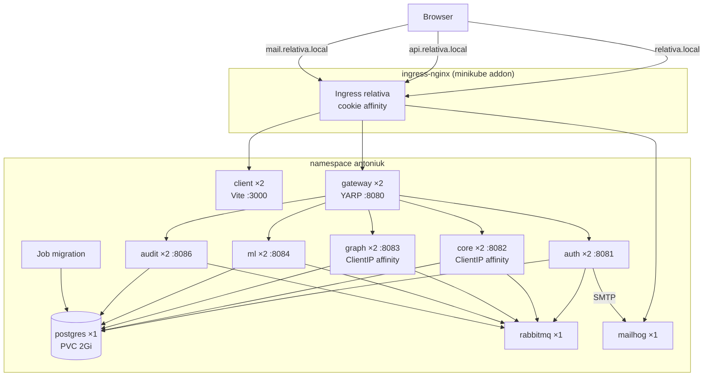

# Kubernetes -- Manifests, Topology, and Operations Model

> **Last verified:** 2026-10-22 (Pointer to the Helm chart that mirrors these manifests.) Earlier: 2026-10-08 (Initial `k8s/` manifests: full stack in namespace `antoniuk` on minikube, release images `1.0.0`, Ingress hosts `relativa.local` / `api.relativa.local` / `mail.relativa.local`.)

> **Maintenance obligation:** If you change anything under `k8s/`, add or remove a service, change a service's env vars, ports, health endpoints, or image names, update this file and its "Last verified" date before finishing your task. A new env var used in `docker-compose.yaml` usually needs the same key in the matching Deployment (and, if shared, in `k8s/01-configmap.yaml` / `k8s/02-secret.yaml`). See [AI-GUIDES-INDEX.md](../../AI-GUIDES-INDEX.md) for the full update matrix.

> **Note:** For operational instructions (start the cluster, deploy, access, reset, troubleshooting) see [KUBERNETES-DEPLOY.md](../../KUBERNETES-DEPLOY.md) at the repo root. This guide explains how the manifests fit together and why.

> **Helm chart:** `helm/relativa/` renders the same workloads as templates (names prefixed with the release, e.g. `relativa-gateway`; selectors use `app.kubernetes.io/component` instead of `name`). Everything below about start-up order, probes, configuration and affinity applies to it too; chart-specific mechanics are in [HELM.md](HELM.md). Changes to a workload's env vars, ports, probes or images must be made in both places.

---

## Topology



All objects live in the namespace **`antoniuk`** (the student's surname, as the lab requires). Every Service is `ClusterIP`; the only entry point from the host is the Ingress, reached through `minikube tunnel` on `127.0.0.1`.

---

## Manifest layout

One object per file. `kubectl apply -f k8s/` applies files in lexical order, so the numeric prefix is the dependency order for objects that must exist first (the Namespace before anything namespaced; ConfigMap/Secret/RBAC before pods that reference them).

| Prefix | Files | Objects |
|---|---|---|
| `00` | `00-namespace.yaml` | Namespace `antoniuk` |
| `01–02` | `01-configmap.yaml`, `02-secret.yaml` | ConfigMap `relativa-config`, Secret `relativa-secrets` |
| `03–05` | `migration-waiter-*` | ServiceAccount, Role (`get/list/watch` on `jobs`), RoleBinding |
| `10–16` | `postgres-*`, `rabbitmq-*`, `mailhog-*` | Infrastructure: PVC + Deployment + Service each |
| `20` | `20-migration-job.yaml` | Job `migration` |
| `30–43` | `<service>-deployment.yaml` / `<service>-service.yaml` | auth, core, graph, audit, ml, gateway, client |
| `50` | `50-ingress.yaml` | Ingress `relativa` |

Labels: every object carries `app.kubernetes.io/part-of: relativa`; workloads also have `app.kubernetes.io/name: <service>` (used by `selector.matchLabels`, the pod template, and the Service selector — keep the three identical) and `app.kubernetes.io/component`.

---

## Images

| Workload | Image |
|---|---|
| gateway, auth, core, graph, audit, ml, client, migration | `ghcr.io/totalbyte/relativa-<service>:1.0.0` (release tags from CI, see [CI-PIPELINE.md](CI-PIPELINE.md)) |
| postgres | `postgres:16-alpine` |
| rabbitmq | `rabbitmq:3.13-management-alpine` |
| mailhog | `mailhog/mailhog:v1.0.1` |
| init: wait-for-migration | `registry.k8s.io/kubectl:v1.37.1` |
| init: wait-for-rabbitmq | `busybox:1.37` |

Never pin `latest` in `k8s/`: a release is the immutable `<major>.<minor>.<patch>` tag. The GHCR packages are public, so no `imagePullSecrets` are needed.

---

## Start-up order (replaces Compose `depends_on`)

Kubernetes starts everything at once; ordering is enforced by the pods themselves:

1. **Job `migration`** — init container `wait-for-postgres` (`pg_isready` loop), then the migration image runs EF `MigrateAsync()` and exits 0. `restartPolicy: OnFailure`, `backoffLimit: 6`.
2. **auth, core, graph, audit, ml** — two init containers:
   - `wait-for-migration`: `kubectl wait --for=condition=complete job/migration --timeout=10m`. The pod runs as ServiceAccount `migration-waiter`, whose Role allows reading Jobs in the namespace. Equivalent of `service_completed_successfully`.
   - `wait-for-rabbitmq`: `nc -z $RABBITMQ_HOST $RABBITMQ_PORT` loop.
3. **gateway, client** — no init containers; YARP and Vite start without upstreams and readiness gates traffic.

Consequences:
- The Job must stay in the namespace (no `ttlSecondsAfterFinished`): every new backend pod — scaling, self-healing, rolling update — re-runs `kubectl wait`, which returns immediately for a completed Job but would block forever if the Job were deleted.
- A Job's pod template is immutable. To run migrations for a new release: `kubectl delete job migration -n antoniuk` and re-apply the file.

---

## Configuration

### ConfigMap `relativa-config`

Mounted into most containers with `envFrom`, so every key becomes an env var.

| Key | Value | Used by |
|---|---|---|
| `ASPNETCORE_ENVIRONMENT` | `Development` | .NET services |
| `DB_HOST` / `DB_PORT` / `DB_NAME` / `DB_USER` | `postgres` / `5432` / `relativa` / `relativa` | all DB users, postgres init |
| `RABBITMQ_HOST` / `RABBITMQ_PORT` / `RABBITMQ_USER` | `rabbitmq` / `5672` / `relativa` | auth, core, graph, audit, ml, rabbitmq |
| `JWT_ISSUER` / `JWT_AUDIENCE` | `relativa-auth` / `relativa` | auth, gateway, audit |
| `SMTP_HOST` / `SMTP_PORT` / `SMTP_FROM_ADDRESS` / `SMTP_FROM_NAME` / `SMTP_USE_SSL` | `mailhog` / `1025` / … | auth |
| `APP_FRONTEND_BASE_URL` | `http://relativa.local` | auth (links in emails) |
| `CORS_ORIGIN` | `http://relativa.local` | gateway (`Cors__Origins__0`) |
| `GATEWAY_PUBLIC_URL` | `http://api.relativa.local` | gateway (`Gateway__PublicBaseUrl`, Scalar server URL) |
| `VITE_GATEWAY_URL` | `http://api.relativa.local` | client (Vite reads `VITE_*` from the process env) |

### Secret `relativa-secrets`

Declared with `stringData` and **dev-only values** (no real credentials). Each key is mapped individually with `secretKeyRef`, so only the containers that need a secret receive it (the client gets none).

| Key | Used by |
|---|---|
| `DB_PASS` | postgres (`POSTGRES_PASSWORD`), migration, auth, core, graph, audit, ml |
| `RABBITMQ_PASS` | rabbitmq (`RABBITMQ_DEFAULT_PASS`), auth, core, graph, audit, ml (`RABBITMQ_PASSWORD`) |
| `JWT_SECRET` | auth, gateway, audit |

### Composing .NET settings

.NET services expect their own keys (`ConnectionStrings__Default`, `Jwt__SecretKey`, `RabbitMqAudit__Host`, …). These are declared in each container's `env` using dependent-variable references, e.g.

```yaml
- name: ConnectionStrings__Default
  value: Host=$(DB_HOST);Port=$(DB_PORT);Database=$(DB_NAME);Username=$(DB_USER);Password=$(DB_PASS)
```

`$(VAR)` resolves against variables from `envFrom` and earlier `env` entries, so the password stays only in the Secret. The per-service keys mirror `docker-compose.yaml`; keep both in sync.

---

## Workloads

| Deployment | Replicas | Port | Readiness | Liveness | requests → limits |
|---|---|---|---|---|---|
| auth | 2 | 8081 | `GET /health` (EF DB check) | TCP | 50m/128Mi → 500m/384Mi |
| core | 2 | 8082 | `GET /health` | TCP | 50m/128Mi → 500m/384Mi |
| graph | 2 | 8083 | `GET /` | TCP | 50m/128Mi → 500m/384Mi |
| audit | 2 | 8086 | `GET /health` | TCP | 50m/128Mi → 500m/384Mi |
| ml | 2 | 8084 | `GET /api/ml/health/` | same | 100m/384Mi → 1/768Mi |
| gateway | 2 | 8080 | `GET /health` | same | 50m/128Mi → 500m/256Mi |
| client | 2 | 3000 | `GET /` | same | 100m/256Mi → 1/768Mi |
| postgres | 1 (`Recreate`) | 5432 | `pg_isready` | same | 100m/256Mi → 500m/512Mi |
| rabbitmq | 1 (`Recreate`) | 5672, 15672 | `rabbitmq-diagnostics check_port_connectivity` | TCP | 100m/256Mi → 500m/512Mi |
| mailhog | 1 | 1025, 8025 | TCP 1025 | `GET /` :8025 | 10m/32Mi → 100m/128Mi |

- **Probe design.** Readiness may depend on the database (a pod without DB access should not receive traffic); liveness for DB-backed .NET services is a TCP check, so a database outage takes pods out of rotation instead of restart-looping them. HTTP probes use `timeoutSeconds: 3`: the first EF health check after start takes ~2 s, and the 1 s default made pods flap out of the endpoints.
- **Rolling updates.** App Deployments use `RollingUpdate` with `maxSurge: 1`, `maxUnavailable: 0` — a new pod must pass readiness before an old one is removed, which keeps the app available during updates (verified with k6: 997 requests, 0 failed, across an update and a rollback).
- **Single-replica infrastructure.** Postgres writes to a `ReadWriteOnce` volume (two instances would corrupt it); two independent RabbitMQ pods would be two separate brokers; MailHog keeps mail in memory. `Recreate` avoids two instances overlapping during an update.
- **Measured footprint** (idle, 17 pods): ~2.5 GB RAM on the node.

---

## Networking

### Services

All `ClusterIP`, named after the compose services (`postgres`, `rabbitmq`, `auth`, …) so in-cluster DNS names match compose and the Gateway's YARP destinations (`http://auth:8081/` etc.) are the same strings as in `docker-compose.yaml`.

### Ingress `relativa` (ingressClassName `nginx`)

| Host | Backend |
|---|---|
| `relativa.local` | `client:3000` |
| `api.relativa.local` | `gateway:8080` |
| `mail.relativa.local` | `mailhog:8025` |

The SPA is cross-origin to the API (`relativa.local` → `api.relativa.local`), so the gateway's CORS allowlist must contain `http://relativa.local` (`CORS_ORIGIN`). Vite 6 rejects unknown Host headers; `Client/vite.config.ts` allows `relativa.local` via `server.allowedHosts` (baked into the image from `1.0.0`).

### Session affinity (SignalR)

Core (`/core/hubs/core`) and Graph (`/graph/hubs/graph`) host SignalR hubs without a backplane, and both run 2 replicas. A SignalR connection (negotiate + transport) must stay on one pod, and the path has two load balancers:

1. Browser → gateway pod: Ingress cookie affinity (`nginx.ingress.kubernetes.io/affinity: cookie`, cookie `relativa-affinity`). The SignalR client sends cookies, so hub traffic sticks to one gateway pod. Plain API `fetch` calls do not send credentials and are spread across gateway pods, which is fine.
2. Gateway pod → core/graph pod: `sessionAffinity: ClientIP` on the `core` and `graph` Services; the client IP is the gateway pod, so each gateway pod sticks to one core and one graph pod.

Known limitation: without a backplane (e.g. Redis), a hub message produced on one replica only reaches clients connected to that replica (e.g. a workspace event consumed by graph pod A is not pushed to browsers on graph pod B). Domain consumers on both graph replicas compete for the same queue. Real-time updates are therefore partial with 2 replicas; data correctness is unaffected (the next HTTP fetch is complete).

The ingress also raises `proxy-read-timeout` / `proxy-send-timeout` to 3600 s so long-lived WebSockets are not cut at the nginx default of 60 s.

---

## Storage

| PVC | Size | Mode | Mounted at |
|---|---|---|---|
| `postgres-data` | 2Gi | ReadWriteOnce | `/var/lib/postgresql/data` (`PGDATA=/var/lib/postgresql/data/pgdata`, a sub-directory so `initdb` does not trip over the volume root) |

minikube's default StorageClass (`standard`, `storage-provisioner` addon) provisions it as a hostPath volume inside the node. Data survives pod restarts and `minikube stop`; it is deleted with the namespace or `minikube delete`.

---

## Operations model

- **Source of truth is `k8s/`.** `kubectl apply` records the applied spec in `kubectl.kubernetes.io/last-applied-configuration`; imperative commands (`set image`, `scale`, `rollout undo`) change the live object only. The next `kubectl apply -f k8s/` reverts them to the file. Make lasting changes in the manifests.
- **Upgrading a release.** Change the image tag in the Deployment file(s) (and the migration Job if the schema changed — delete the old Job first), then `kubectl apply -f k8s/`. Record the reason with `kubectl annotate deployment/<name> kubernetes.io/change-cause="..."` so it shows in `kubectl rollout history`.
- **Version check.** `GET http://api.relativa.local/version` returns the gateway's release version and serving pod name; the client footer on the login page shows the version from `1.1.0`.
- **Availability check.** `tests/load/rollout-availability.js` (k6, 10 req/s on `/version`, fails on any non-200) counts responses per version during a rollout.

---

## Differences from Docker Compose

| Concern | Compose | Kubernetes |
|---|---|---|
| Start order | `depends_on` + healthchecks | init containers (`kubectl wait` on the Job, `nc` on RabbitMQ) |
| Migrations | run-to-completion service | Job `migration` |
| Config | `.env` → `${VAR}` substitution | ConfigMap + Secret → `envFrom` / `secretKeyRef` / `$(VAR)` |
| Host access | every service publishes a host port | only the Ingress (via `minikube tunnel`); services are ClusterIP |
| Replicas | 1 each | 2 per app service, 1 for stateful infra |
| Images | built locally (or `docker-compose.images.yaml`) | GHCR release tags |
| pgAdmin | included | not deployed (use `kubectl port-forward svc/postgres 5432 -n antoniuk`) |
| ML `DB_PORT` | host port leaks in (known issue) | container port `5432` from the ConfigMap |
